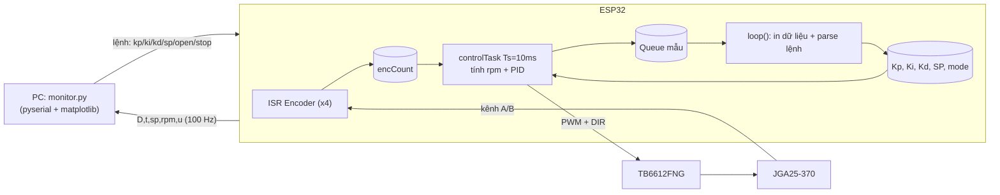
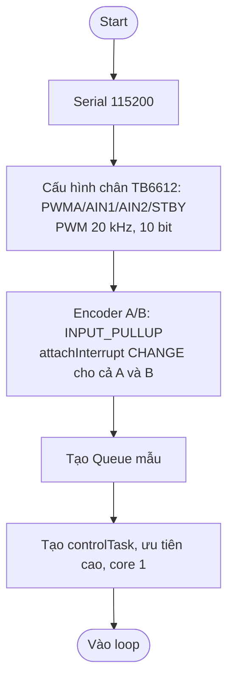
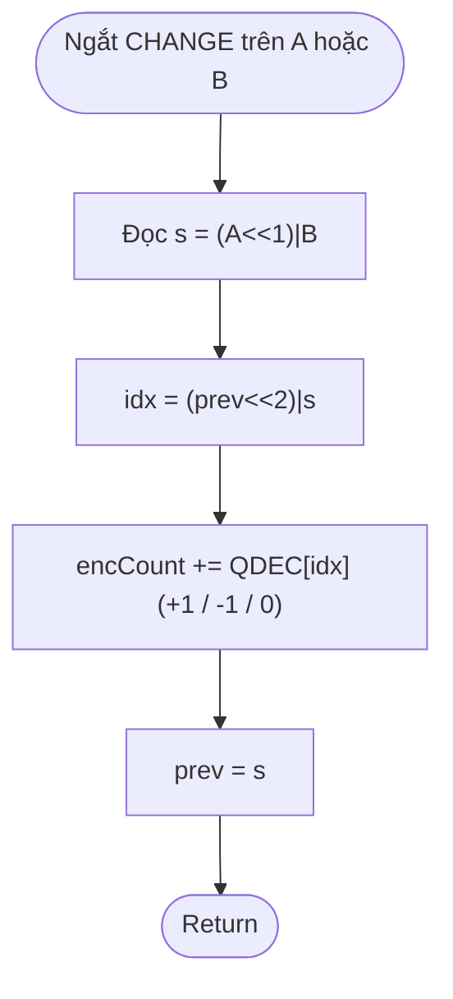
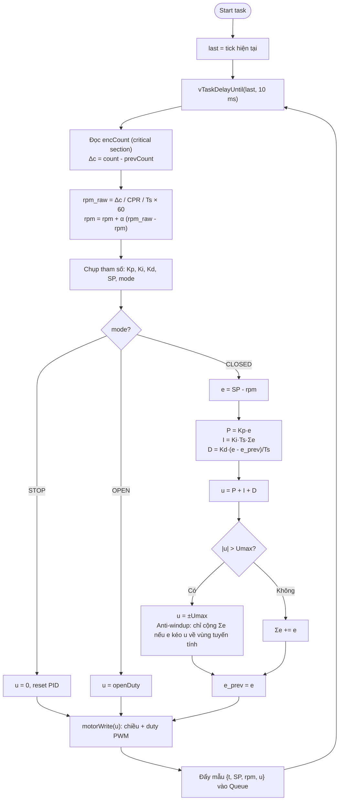
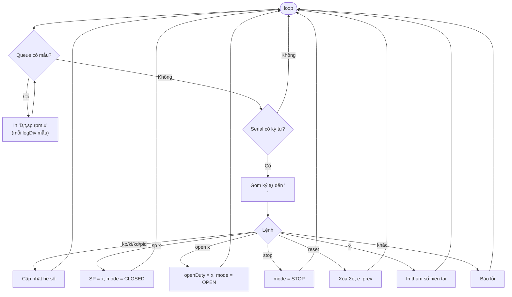
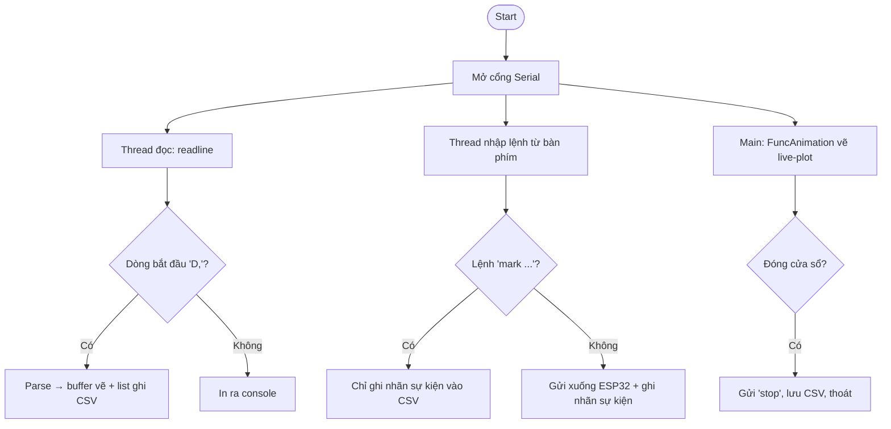
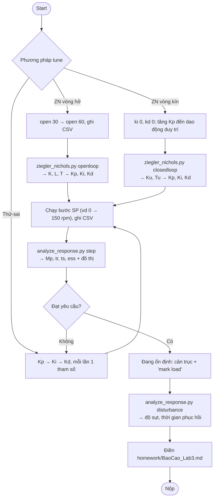

# Lab 3 – Lưu đồ thuật toán PID rời rạc (vận tốc động cơ DC)

Công thức rời rạc (Ts = 10 ms):

$$u[k] = K_p e[k] + K_i T_s \sum_{j=0}^{k} e[j] + K_d \frac{e[k]-e[k-1]}{T_s}$$

## 1. Tổng quan hệ thống

## 2. setup()

## 3. ISR encoder (giải mã cầu phương x4)

## 4. controlTask – vòng lặp PID chu kỳ cố định 10 ms

## 5. loop() – giao tiếp Serial

## 6. monitor.py (PC)

## 7. Quy trình bài tập về nhà

