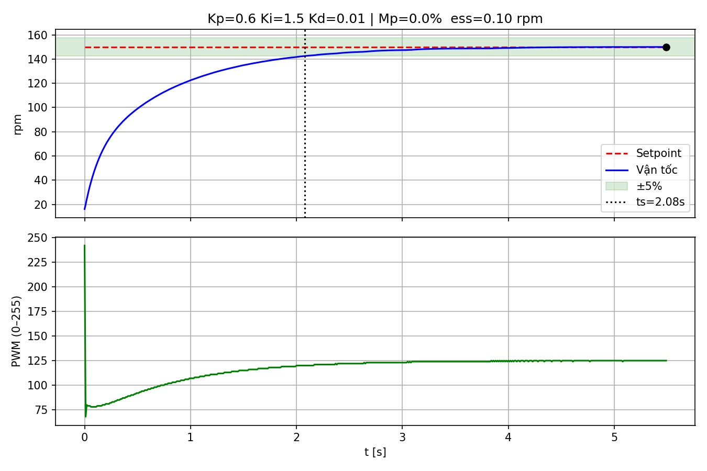
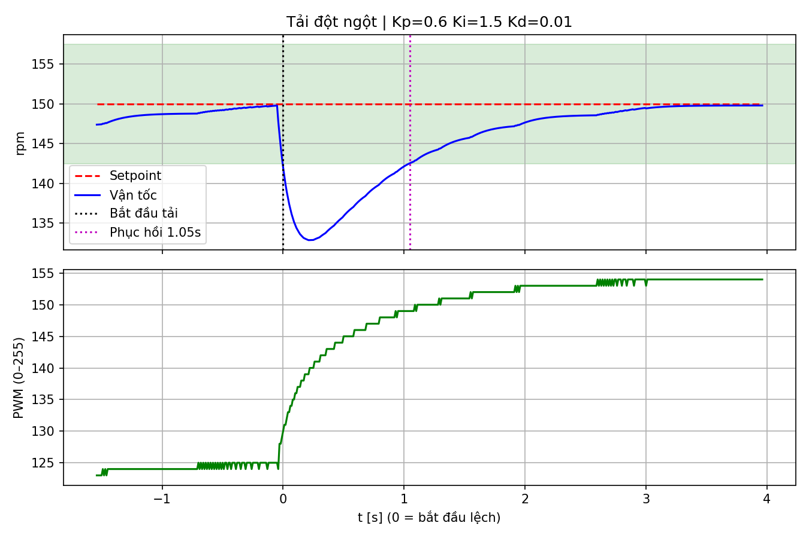

# BÁO CÁO LAB 3 – VÒNG LẶP PID RỜI RẠC

**Họ tên / Nhóm:** ...............  **Đề tài đồ án:** ...............  **Ngày:** ..........

> **Lưu ý về dữ liệu:** Các bảng và đồ thị PID điền ở mục 2–3 bên dưới là dữ liệu **mô phỏng**, không phải kết quả đo phần cứng. Mô hình giả định tốc độ theo đơn vị rpm và đối tượng bậc nhất; firmware hiện tại gửi `ticks/s`, vì vậy cần hiệu chuẩn CPR và quy đổi đơn vị trước khi đối chiếu với thực nghiệm.

## 1. Cấu hình phần cứng & đo vận tốc (2đ)

| Thông số | Giá trị |
|---|---|
| Động cơ / tỉ số truyền | JGA25-370, 1:___ |
| Encoder PPR (trục động cơ) | 11 |
| Kiểu giải mã | x4 → CPR = ___ count/vòng trục ra |
| Chu kỳ lấy mẫu Ts | 10 ms |
| Độ phân giải vận tốc (1 count / Ts) | 60 / (CPR·Ts) = ___ rpm |
| Lọc vận tốc | EMA, α = ___ |

Kiểm chứng vận tốc: so sánh rpm đo được với ___ (đếm số vòng trong 60 s / tachometer / điện thoại quay chậm).

| Duty (%) | rpm encoder | rpm kiểm chứng | Sai số (%) |
|---|---|---|---|
| 30 | | | |
| 60 | | | |
| 90 | | | |

## 2. Tune PID (3đ + 2đ)

### 2.1 Phương pháp: ☐ Ziegler-Nichols vòng kín ☐ ZN vòng hở ☒ Thử-sai trên mô hình mô phỏng

- Không có dữ liệu Ku/Tu hoặc đường cong phản ứng thực nghiệm; các kết quả bên dưới chỉ minh họa việc thay đổi P → PI → PID trong mô hình.

### 2.2 Nhật ký tune mô phỏng (setpoint bước 0 → 150 rpm, dải xác lập ±5%)

| Lần | Kp | Ki | Kd | Mp (%) | tr (s) | ts (s) | ess (rpm) | Nhận xét |
|---|---|---|---|---|---|---|---|---|
| Mô phỏng P | 1.2 | 0 | 0 | 0.0 | — | — | 61.68 | Không vào dải ±5% trong 6 s; còn sai số xác lập lớn |
| Mô phỏng PI | 0.7 | 1.2 | 0 | 0.0 | 1.980 | 2.810 | 1.29 | Tích phân giảm sai số xác lập |
| Mô phỏng PID | 0.6 | 1.5 | 0.01 | 0.0 | 1.510 | 2.080 | 0.10 | Dải xác lập ±5%; mô hình không có nhiễu đo |

### 2.3 Thông số chọn cuối cùng

| Kp | Ki | Kd | Mp (%) | ts (s) | ess (%) |
|---|---|---|---|---|---|
| 0.6 | 1.5 | 0.01 | 0.0 | 2.080 | 0.07 |

## 3. Thử nghiệm tải đột ngột

| Kp | Ki | Kd | Độ lệch max (rpm) | Độ lệch max (%) | T phục hồi (s) | ΔPWM bù tải (count) |
|---|---|---|---|---|---|---|
| 0.6 | 1.5 | 0.01 | -17.1 | 11.4 | 1.050 | 27.8 |

Nhận xét mô phỏng: khâu I tích lũy sai lệch khi tải tăng, làm PWM tăng để bù mô-men và đưa tốc độ về dải đặt.

## 4. Áp dụng PID cho đồ án (150–250 từ) (2đ)

> Gợi ý trả lời: (1) biến được điều khiển thay cho vận tốc (nhiệt độ / mực nước / góc nghiêng / khoảng cách...);
> (2) cảm biến đo và tần số lấy mẫu phù hợp (Ts lớn hơn nhiều cho nhiệt độ, nhỏ hơn cho cân bằng);
> (3) cơ cấu chấp hành và đầu ra u (PWM MOSFET, góc servo, PWM động cơ...);
> (4) đặc tính đối tượng (chậm/nhanh, trễ, có tích phân hay không) → khâu P/I/D nào quan trọng, có cần anti-windup, lọc D;
> (5) cách tune và tiêu chí đạt.

Trong đồ án Lab3, biến được điều khiển là tốc độ quay của động cơ DC; giá trị đặt là 150 rpm trong mô hình, còn phần cứng hiện tại đo số xung encoder trong mỗi chu kỳ 10 ms. Cần xác định CPR hiệu dụng và quy đổi tick/s sang rpm trước khi so sánh với số đo thực tế. ESP32 đọc encoder ở chân ngắt, tính sai lệch giữa tốc độ đặt và đo được, rồi cập nhật PID rời rạc mỗi Ts = 10 ms. Tín hiệu điều khiển u là PWM 8-bit (0–255) đưa tới driver TB6612 để thay đổi điện áp trung bình và mô-men động cơ. Khâu P phản ứng trực tiếp với sai lệch; I tích lũy sai số để bù tải và giảm sai số xác lập; D dự đoán xu hướng thay đổi nhưng nhạy với nhiễu encoder, nên cần lọc nếu dữ liệu thực rung. Khi PWM chạm giới hạn, cần chống bão hòa tích phân để tránh hồi phục chậm. Các hệ số trong bảng được thử trên mô hình bậc nhất giả định, không phải tune từ phần cứng; bộ cuối cho thời gian xác lập mô phỏng 2,08 s trong dải ±5%. Khi có thiết bị, cần ghi dữ liệu thật, hiệu chỉnh tốc độ, tăng tải có kiểm soát, rồi chọn bộ PID dựa trên vọt lố, xác lập và phục hồi.

## 5. Kết luận

...
